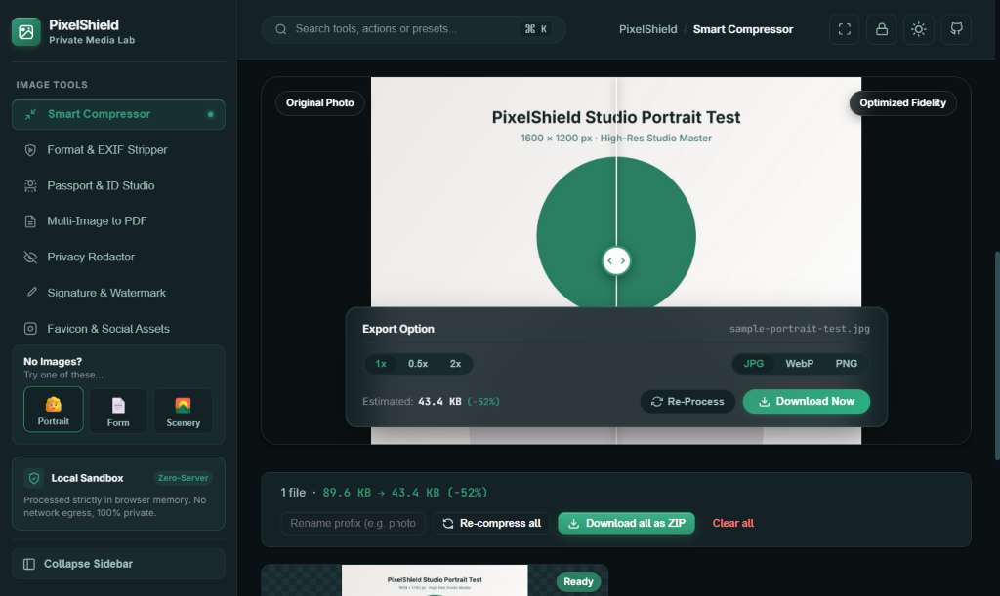
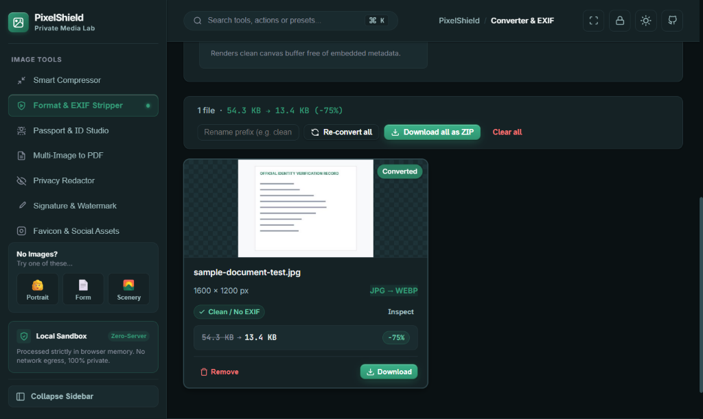
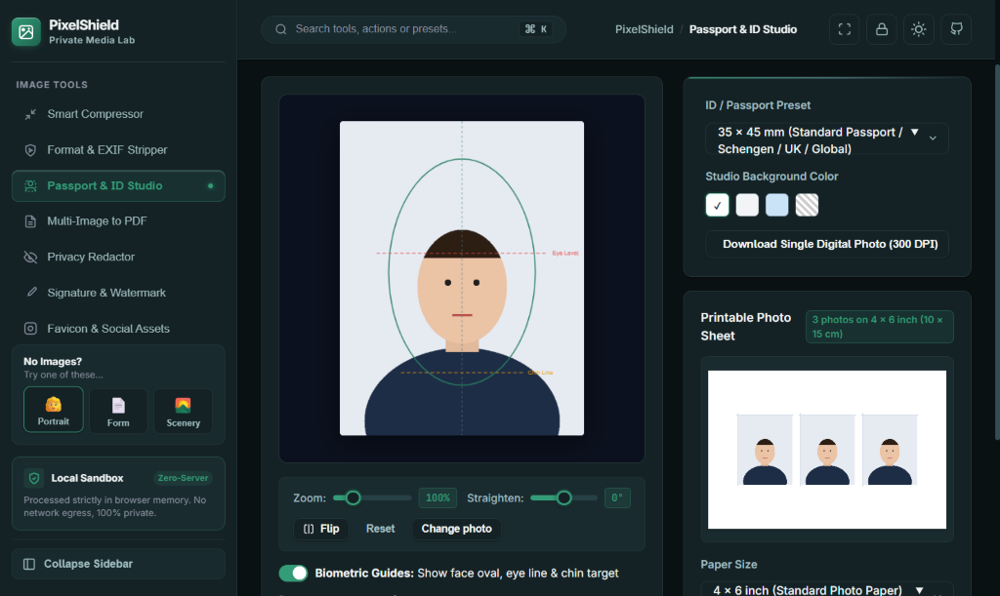
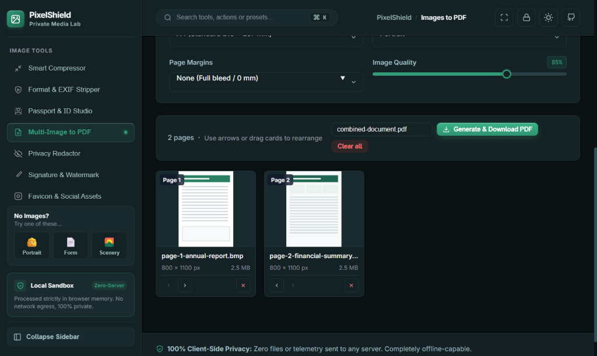
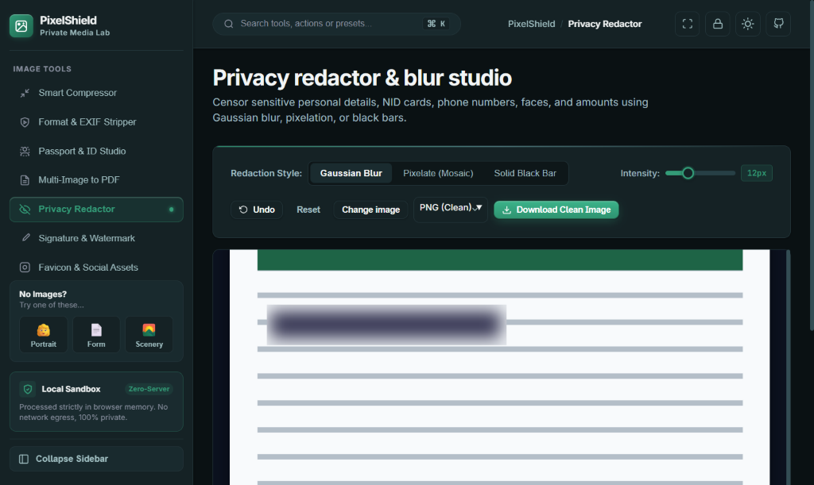
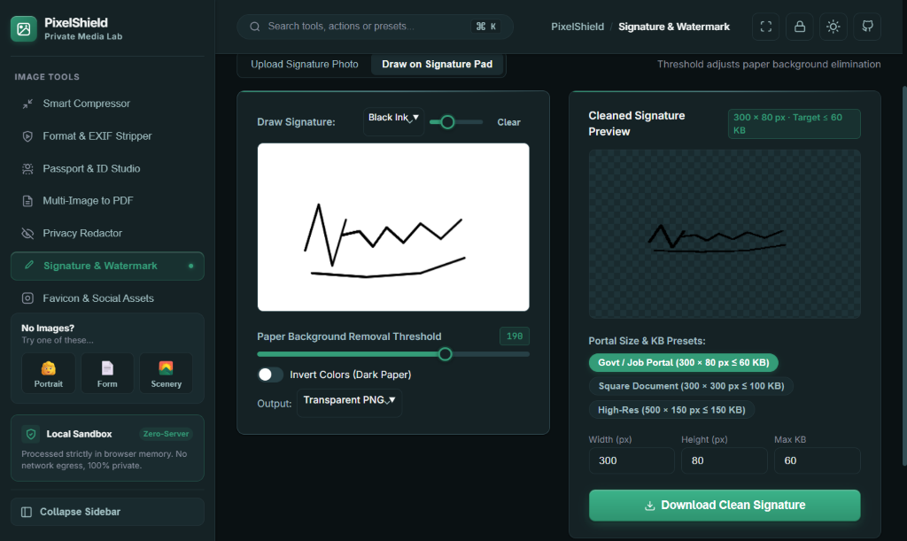
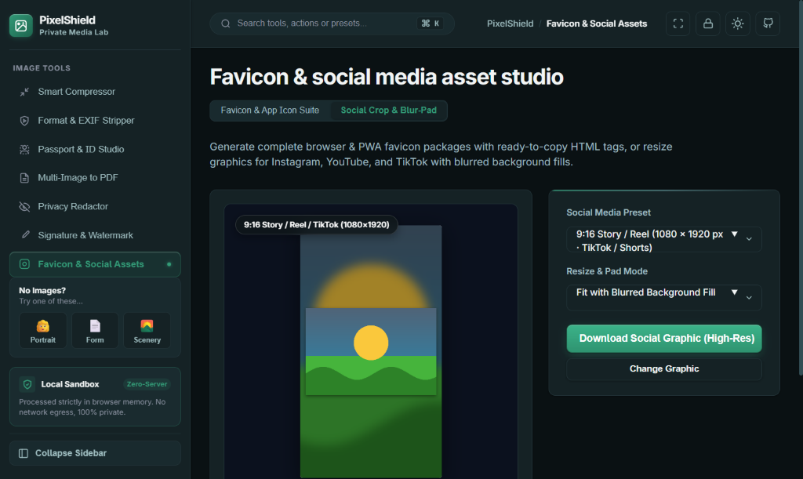
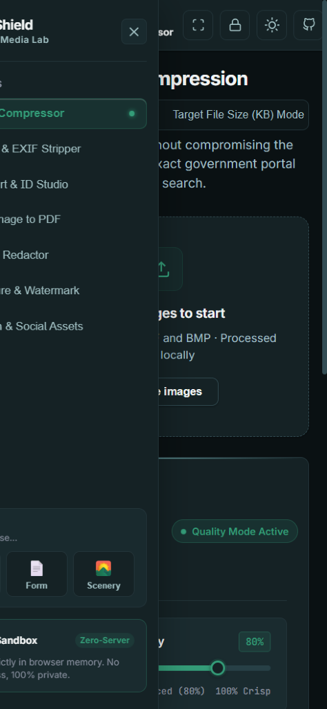

<p align="center">
  
</p>

<p align="center">
  <strong>Desktop-Grade Creative Studio • 100% Client-Side Privacy • Zero Server Uploads • Pure Vanilla ES6+</strong>
</p>

<p align="center">
  <a href="https://zhsaikot.github.io/pixelshield/"></a>
  <a href="#-the-7-in-1-studio-suite"></a>
  <a href="#-zero-server-privacy-guarantee"></a>
  <a href="https://github.com/zhsaikot/pixelshield/blob/main/LICENSE"></a>
</p>

---

## 🌟 Overview

**PixelShield** is a professional, **100% client-side privacy media lab and desktop-grade image processing studio**. It delivers the speed, tactile responsiveness, and aesthetic polish of modern desktop software (inspired by Linear, Raycast, and PixorAI) entirely inside your web browser.

Every single operation — smart target-KB compression, EXIF metadata purging, international biometric passport cropping, multi-image PDF compilation, sensitive document redaction, job portal signature transparency cleaning, and social media blurred-fill asset creation — **executes strictly in browser memory via HTML5 Canvas, Web Blobs, and native ES6 algorithms**.

> [!IMPORTANT]
> **Zero Network Egress:** Your photos, signatures, IDs, and financial documents are **NEVER uploaded to any server, cloud API, or third-party backend**. PixelShield works 100% offline.

---

## 📑 Table of Contents

- [🛡️ Zero-Server Privacy Guarantee](#️-zero-server-privacy-guarantee)
- [✨ Key Studio Features](#-key-studio-features)
- [🎨 The 7-in-1 Studio Suite](#-the-7-in-1-studio-suite)
  - [1. Smart Image Compressor & Target-KB Engine](#1-smart-image-compressor--target-kb-engine)
  - [2. Format Converter & EXIF Stripper](#2-format-converter--exif-stripper)
  - [3. Biometric Passport & ID Photo Studio](#3-biometric-passport--id-photo-studio)
  - [4. Multi-Image to PDF Document Studio](#4-multi-image-to-pdf-document-studio)
  - [5. Privacy Redactor & Censor Studio](#5-privacy-redactor--censor-studio)
  - [6. Signature Cleaner & Watermark Studio](#6-signature-cleaner--watermark-studio)
  - [7. Favicon Suite & Social Media Asset Studio](#7-favicon-suite--social-media-asset-studio)
- [📱 Full Cross-Device Responsiveness](#-full-cross-device-responsiveness)
- [⌨️ Keyboard Shortcuts](#️-keyboard-shortcuts)
- [⚡ Running Locally & Offline](#-running-locally--offline)
- [👨‍💻 Author & Acknowledgements](#-author--acknowledgements)
- [📄 License](#-license)

---

## 🛡️ Zero-Server Privacy Guarantee

Traditional online image converters upload your files to remote cloud servers for processing, creating significant risks for identity theft, location tracking, and corporate confidentiality leaks.

| Privacy Vector | Standard Online Tools (CloudConvert, TinyPNG, etc.) | **PixelShield Private Media Lab** |
| :--- | :--- | :--- |
| **Server Upload** | ⚠️ Full file transferred to third-party cloud | 🛡️ **Zero bytes uploaded; processed in browser RAM** |
| **GPS & EXIF Metadata** | ⚠️ Stored on remote server disks | 🛡️ **EXIF scrubbed locally through clean canvas re-rasterization** |
| **Offline Capability** | ❌ Fails without active internet connection | 🛡️ **Fully functional offline / airplane mode / local intranet** |
| **Data Retention** | ⚠️ Retained 1-24 hrs on remote disks | 🛡️ **Discarded instantly upon tab closure** |
| **Telemetry & Tracking** | ⚠️ Google Analytics, ad beacons, cookies | 🛡️ **Zero analytics, zero tracking, zero external APIs** |

---

## ✨ Key Studio Features

- **⚡ 8-Pass Binary Search Target-KB Engine:** Hit exact government portal and document upload size caps (e.g. `under 50 KB`, `under 100 KB`, `under 200 KB`) automatically without guesswork.
- **🎛️ Interactive Before/After Split Canvas:** Smooth real-time split divider comparing the original source against the compressed output side-by-side with zero latency.
- **🚀 1-Click Synthetic Sample Presets:** Built-in sample generators in the sidebar (`👩 Portrait`, `📑 Form`, `🌅 Scenery`) to test every feature instantly without hunting for files.
- **⌘K Quick Command Palette:** Keyboard-driven fuzzy-search switcher to jump between any tool or preset in milliseconds.
- **🌲 Nordic Botanical Design System:** Ergonomic Linear/Raycast-inspired aesthetic with deep forest greens, subtle dark/light theme switching, and smooth 60fps micro-animations.
- **📦 Smart Batch Processing & ZIP Export:** Process dozens of files at once, preview live savings percentages, rename with custom prefixes, and export individual files or bundled ZIP archives.

---

## 🎨 The 7-in-1 Studio Suite

### 1. Smart Image Compressor & Target-KB Engine
> **Subpath:** `#compress` • **Core Tech:** HTML5 Canvas, Binary Search, In-Memory Offscreen Compression

<p align="center">
  
</p>

- **Dual Optimization Modes:**
  - **Quality & Resize Mode:** Fine-tune visual fidelity slider (1% to 100%), select output format (WebP / JPEG / PNG), and apply max-width/max-height constraints with aspect-ratio locking.
  - **Target File Size (KB) Mode:** Enter target size caps (e.g. `80 KB`). An 8-pass binary search algorithm iteratively converges on the ideal compression factor and resolution downscaling to guarantee strict compliance.
- **Interactive Before/After Stage:** Compare zoom, sharpness, and compression artifacts side-by-side with draggable split slider.
- **Floating Export Dock:** Instant 1-click scale switches (`0.5x`, `1x`, `2x`), format toggles, and live estimated savings badge.
- **File Queue Cards:** Visual batch cards with before/after byte counts, savings badge (e.g. `-52%`), Compare button, and instant single-file download.

---

### 2. Format Converter & EXIF Stripper
> **Subpath:** `#convert` • **Core Tech:** Canvas Offscreen Rendering, APP1/APP2 Metadata Stripping

<p align="center">
  
</p>

- **Universal Batch Conversion:** Seamlessly convert between **WebP**, **JPEG**, and **PNG** formats with individual or batch controls.
- **Transparency Protection & Background Fills:** Select custom fill colors (`#FFFFFF`, `#000000`, `#F3F4F6`, or custom hex) when converting transparent PNG/WebP files into JPEG.
- **Zero-Leak EXIF Purging:** Automatically strips all EXIF metadata tags, GPS latitude/longitude coordinates, camera serial numbers, lens info, and timestamps by passing image data through a sanitized canvas rasterizer.
- **Metadata Inspector:** Inspect detected camera metadata prior to sanitization with an indicator badge.

---

### 3. Biometric Passport & ID Photo Studio
> **Subpath:** `#passport` • **Core Tech:** Canvas Transforms, Touch/Mouse Pan & Zoom, 300 DPI Grid Rendering

<p align="center">
  
</p>

- **International Standards Presets:**
  - `35 × 45 mm` (Standard Passport / Schengen / UK / Australia / Global @ 300 DPI)
  - `2 × 2 inch` (US Passport & Visa / India Visa @ 300 DPI)
  - `300 × 300 px` (Digital Portals & Govt Job Application Uploads)
  - `35 × 35 mm` (Japan / Asian ID)
  - `50 × 70 mm` (Canadian Passport Standard)
- **Biometric Head Guidelines:** Overlay ICAO-compliant chin level, crown level, and eye-level alignment markers directly on the viewport.
- **Interactive Editing:** Smooth mouse/touch drag panning, zoom slider (50% to 300%), angle rotation (-45° to +45°), and horizontal flip.
- **Printable Sheet Generator:** Automatically arranges multiple tiled photos onto standard paper sheets (`A4`, `4×6 Photo Card`, `US Letter`) with optional cut guidelines for home or studio printing.

---

### 4. Multi-Image to PDF Document Studio
> **Subpath:** `#img-to-pdf` • **Core Tech:** Client-side jsPDF Compilation, Drag-and-Drop Page Grid

<p align="center">
  
</p>

- **Drag-and-Drop Page Arrangement:** Upload unlimited photos, document scans, or receipts, and easily reorder pages with move left/right controls.
- **Configurable Document Layouts:**
  - Page Formats: `A4`, `US Letter`, or `Fit to Image Dimensions`.
  - Orientations: `Portrait`, `Landscape`, or `Auto-Detect per image`.
  - Margins: `None (Full Bleed)`, `Compact (8mm)`, or `Standard (15mm)`.
- **In-Memory PDF Generation:** Compiles all pages directly into a single `.pdf` document without sending any page data over the wire.

---

### 5. Privacy Redactor & Censor Studio
> **Subpath:** `#redact` • **Core Tech:** Pixel Manipulation, Gaussian Blur Kernel, Mosaic Quantization

<p align="center">
  
</p>

- **Protect Sensitive Information:** Conceal bank statements, credit card numbers, national IDs, faces, and home addresses before sharing screenshots or documents.
- **3 Professional Redaction Modes:**
  - **Gaussian Blur:** Smooth visual softening with adjustable intensity slider (5px to 50px).
  - **Mosaic Pixelation:** Discrete block-level pixelation with customizable tile size.
  - **Solid Black Censor Bar:** Opaque redaction bar for absolute security.
- **Multi-Region Selection:** Draw multiple redaction boxes across any part of the image, with undo/redo history and metadata sanitization on export.

---

### 6. Signature Cleaner & Watermark Studio
> **Subpath:** `#signature` • **Core Tech:** Luminance Threshold Binarization, Canvas Drawing Context

<p align="center">
  
</p>

- **Tab A — Signature Background Cleaner:**
  - Upload a mobile snapshot of a handwritten signature on physical paper or draw directly onto the digital signature pad.
  - **Dynamic Threshold Binarization:** Erases off-white shadows, paper grain, and wrinkles, converting the signature into a crisp, transparent PNG.
  - Job portal presets (e.g. `300 × 80 px` under `60 KB`).
- **Tab B — Text & Logo Watermarking:**
  - Protect intellectual property by stamping custom text or logos over your images.
  - Controls for opacity, font size, rotation angle, corner alignment, or full diagonal tiled repeat pattern.

---

### 7. Favicon Suite & Social Media Asset Studio
> **Subpath:** `#assets` • **Core Tech:** Multi-scale Resampling, Dual-Layer Canvas, Blurred Background Padding

<p align="center">
  
</p>

- **Subtab A — Favicon Production Pack:**
  - Upload a single high-resolution square logo and generate all required favicon standards in one click:
    - `16 × 16 px` & `32 × 32 px` (Standard Browser Tab Favicons)
    - `48 × 48 px` (Desktop Shortcut Icon)
    - `180 × 180 px` (Apple Touch Icon for iOS)
    - `192 × 192 px` & `512 × 512 px` (PWA Web App Manifest Icons)
  - Exports a complete ZIP bundle with copy-paste `<link>` HTML tags.
- **Subtab B — Social Media Aspect Ratio Studio:**
  - Convert any photo into optimal social media aspect ratios:
    - **`9:16 Story / Reel`** (`1080 × 1920 px` · TikTok, Instagram Stories, YouTube Shorts)
    - **`1:1 Square`** (`1080 × 1080 px` · Instagram Post, LinkedIn Feed)
    - **`16:9 Landscape`** (`1280 × 720 px` · YouTube Thumbnail, X Header)
    - **`4:5 Portrait`** (`1080 × 1350 px` · Instagram Feed)
  - **Blurred Background Padding:** Automatically fills letterbox margins with a pleasing frosted blur of the original artwork, keeping the primary subject sharp and centered.

---

## 📱 Full Cross-Device Responsiveness

PixelShield is engineered to look and perform flawlessly on every screen size — from high-resolution 4K desktop workstations to compact mobile smartphones.

<p align="center">
  
</p>

- **Desktop (1280px - 1920px+):** Full desktop studio shell with collapsible left navigation (260px ↔ 68px), central interactive stage, and edge-to-edge alignment.
- **Tablet / iPad (768px - 1024px):** Adaptive 2-column to 1-column layout transitions, touch gesture support on canvas, and unclipped toolbar panels.
- **Mobile Phones (320px - 640px):** Off-canvas navigation drawer with backdrop, full-width touch-friendly buttons, and zero horizontal scroll overflow.

---

## ⌨️ Keyboard Shortcuts

Speed up your creative workflow with built-in desktop keyboard shortcuts:

| Shortcut | Action | Description |
| :--- | :--- | :--- |
| <kbd>⌘</kbd> + <kbd>K</kbd> or <kbd>Ctrl</kbd> + <kbd>K</kbd> | **Quick Command Palette** | Opens instant search to jump to any tool or action |
| <kbd>Esc</kbd> | **Close Overlay** | Closes Command Palette, mobile drawer, or open modals |
| <kbd>1</kbd> | **Smart Compressor** | Navigates directly to Tool 1 |
| <kbd>2</kbd> | **Format & EXIF Stripper** | Navigates directly to Tool 2 |
| <kbd>3</kbd> | **Passport & ID Studio** | Navigates directly to Tool 3 |
| <kbd>4</kbd> | **Multi-Image to PDF** | Navigates directly to Tool 4 |
| <kbd>5</kbd> | **Privacy Redactor** | Navigates directly to Tool 5 |
| <kbd>6</kbd> | **Signature & Watermark** | Navigates directly to Tool 6 |
| <kbd>7</kbd> | **Favicon & Social Assets** | Navigates directly to Tool 7 |

---

## ⚡ Running Locally & Offline

PixelShield has **zero build steps, zero package installations, and zero compiler dependencies**. You can run it offline on any computer:

### Option 1: Direct File Open
Simply double-click `index.html` in your file explorer to open it in Chrome, Edge, Firefox, or Safari!

### Option 2: Static HTTP Server
```bash
# Clone the repository
git clone https://github.com/zhsaikot/pixelshield.git
cd pixelshield

# Using Python 3 (built-in)
python -m http.server 8000

# OR using Node.js
npx serve .
```

Open `http://localhost:8000` in your web browser.

---

## 👨‍💻 Author & Acknowledgements

Developed with passion by **MD. Ziaul Hasan**  
- 🌐 **Portfolio & Website:** [mdziaulhasan.com](https://mdziaulhasan.com/)
- 💻 **GitHub:** [@zhsaikot](https://github.com/zhsaikot)
- 🚀 **Live Application:** [zhsaikot.github.io/pixelshield](https://zhsaikot.github.io/pixelshield/)

Special thanks to the open-source community for the client-side dependencies:
- [JSZip](https://stuk.github.io/jszip/) — In-memory client-side ZIP archive compilation.
- [jsPDF](https://github.com/parallax/jsPDF) — In-memory client-side PDF document generation.

---

## 📄 License

This project is licensed under the **MIT License** — see the [LICENSE](LICENSE) file for details. Free and open source for personal and commercial privacy-preserving workflows.
